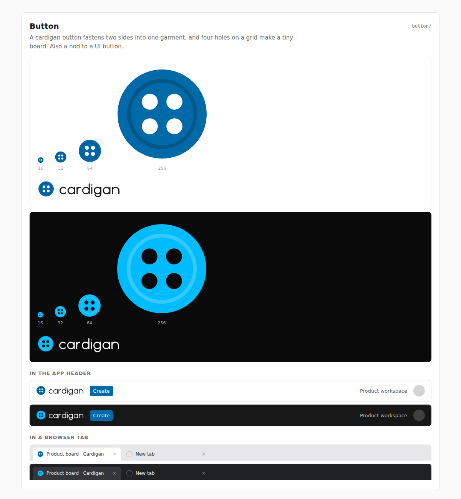

# Button

**Rationale.** A cardigan's button fastens two sides into one garment. Its four
holes sit on a 2x2 grid, like a small board, and it also nods to a UI button. The
holes are 5.2 units wide, so the grid stays visible at 16 px.

**Risk to watch.** The mark is all sky, so people (ink) only appear in the
wordmark, and a round four-dot button can pass for a generic menu or apps icon.
The faint rim is a 1.2-unit flourish that disappears below 64 px; the mark must
not depend on it.
