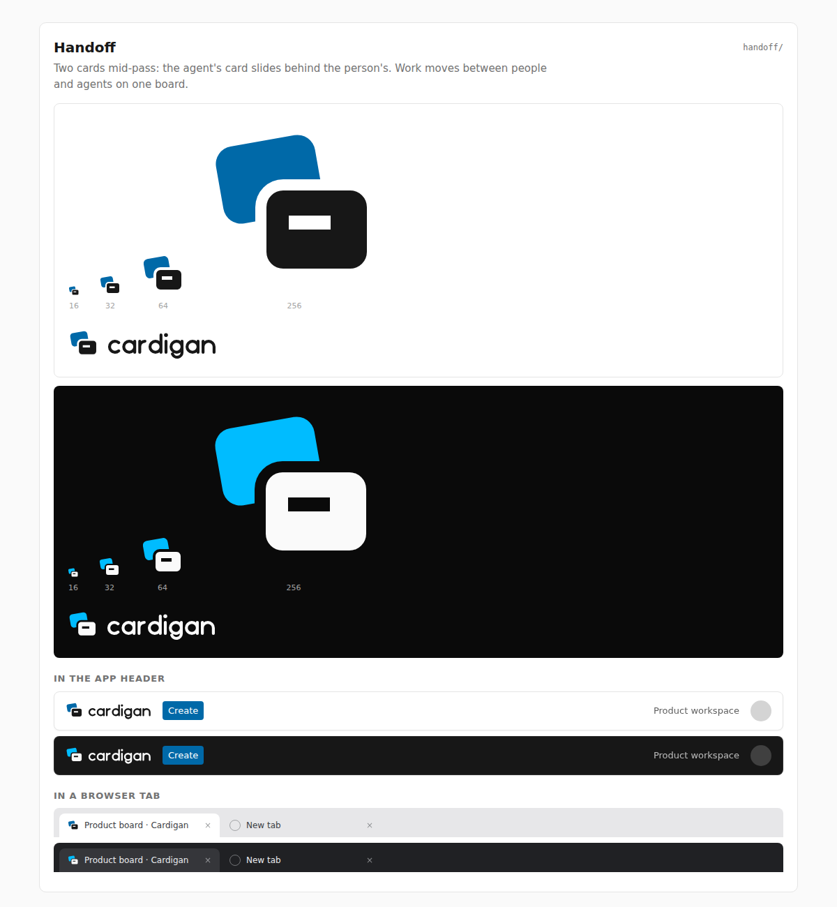

# Handoff

**Rationale.** Two cards mid-pass: the agent's card (sky) is tilted behind the
person's card (ink), caught in the moment work changes hands on a board. The card
shape ties the mark to the product itself.

**Risk to watch.** The cut between the cards (2 units) and the line on the front
card (2.5 units) are finer than the 4-unit rule. At 16 px they still show, but they
are the first details to blur on a low-density screen. If this concept is picked,
widen both to 4 units and recheck the tab strip in the preview.
