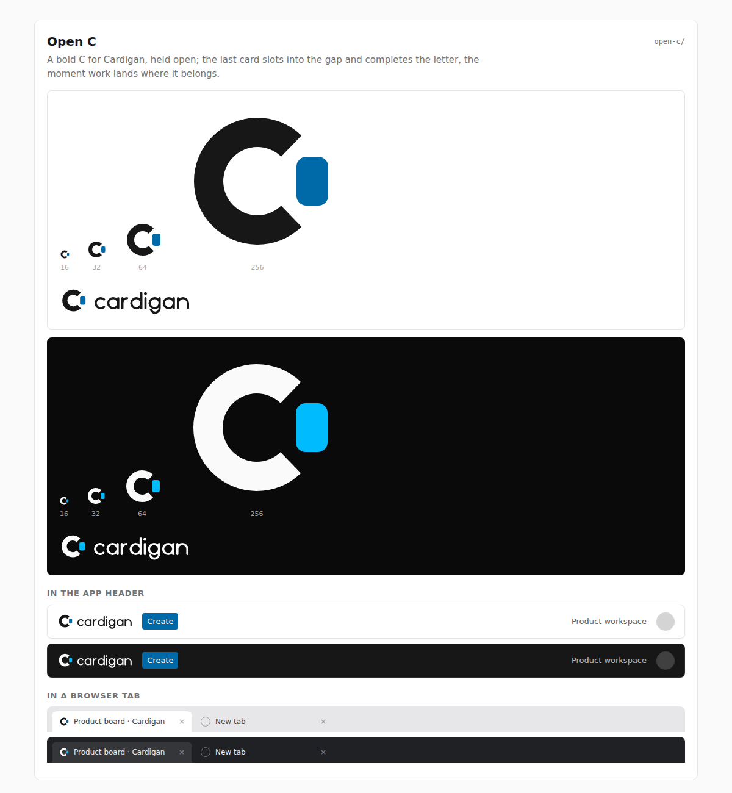

# Open C

**Rationale.** A bold C for Cardigan, held open. The sky card lands in the gap and
completes the letter: the moment work lands where it belongs. The ring is 6 units
thick and the card 6.5 units wide, so both survive at 16 px.

**Risk to watch.** The agent appears only as the small card, about 3 by 5 pixels
at 16 px, so the people-and-agents pairing is the weakest of the five there, and a
plain C is a common letter mark. Check that the card still reads as a card, not a
dot, before choosing it.
