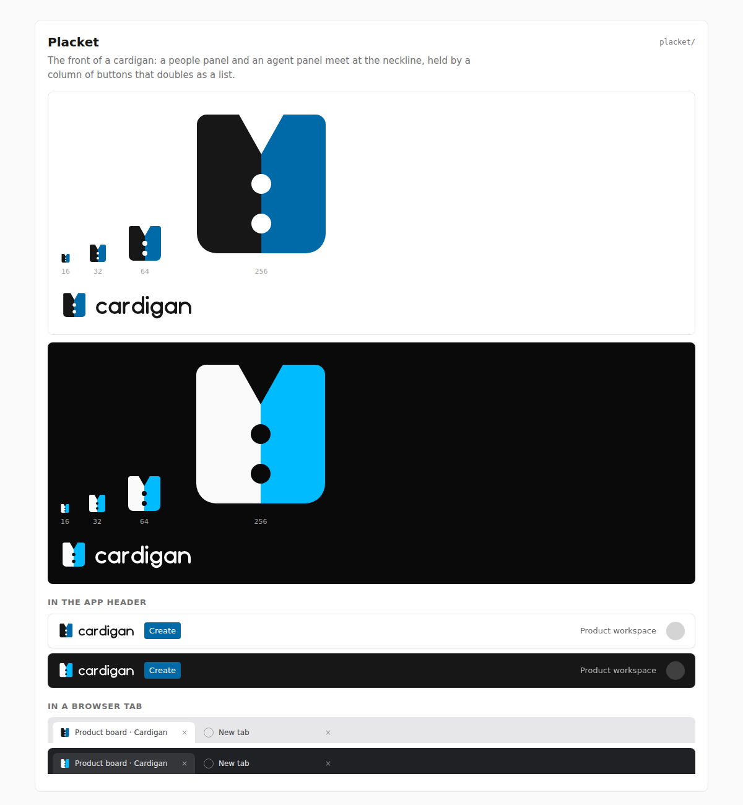

# Placket

**Rationale.** The front of a cardigan: an ink people panel and a sky agent panel
meet at a V neckline, held together by a column of buttons that doubles as a list.

The button holes sit on whole pixels at 16 px (centers 16 and 24, radius 2) with
4-unit gaps to the neckline, to each other and to the hem. An earlier draft had a
thin seam line and off-grid holes that blurred away as a favicon.

**Risk to watch.** Two tall rectangles with a V can read as a jacket, a suit or a
book spine rather than a cardigan. The buttons carry the meaning, so do not shrink
them or add more.
