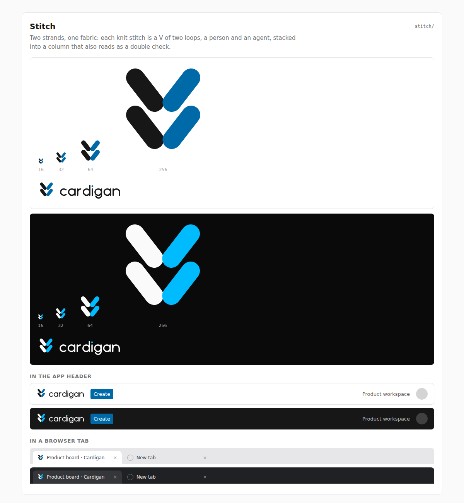

# Stitch

**Rationale.** A knit stitch is a V of two loops. Here one loop is ink (a person)
and one is sky (an agent), and two rows stack into fabric: people and agents
woven into one piece of work. The stacked Vs also read as a double check mark,
work done together. Each loop is a 6-unit round-capped capsule, so the mark holds
together at 16 px.

**Risk to watch.** Thin or pointed loops make the mark read as a leaf, sprout or
wheat ear, as an earlier draft did. Keep the loops as fat, round-ended capsules
and keep both rows the same size; do not taper them.
